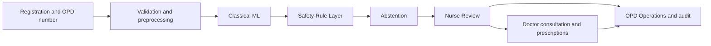

# OPD Sentinel

OPD Sentinel is a connected prototype for an overloaded government hospital outpatient department (OPD). It covers these jobs:

- **Patient portal.** A patient signs up, describes their symptoms in their own words (with optional home readings), and follows the visit on a progress tracker. Red-flag words trigger "go to the desk now / call 108 or 112" advice. The patient never sees a triage level or model output. After the visit they can read the doctor's diagnosis, plan, and prescriptions.
- **Patient check-ins (nurse).** The nurse verifies the patient's identity in person, measures vitals, and registers the check-in. The normal triage pipeline then runs, and the case goes through nurse review to the doctor like any walk-in.
- **Nurse Station.** Register the patient and issue a persistent OPD number. Record vitals and the complaint, review a Classical ML triage recommendation, confirm, override or escalate it, and send the patient to the doctor.
- **Doctor Review.** Work through the doctor queue. Each consultation shows the nurse's assessment and the ML recommendation as decision support. The doctor records examination, assessment, diagnosis and plan, writes prescriptions, and refers or completes the encounter.
- **OPD Operations.** Workload, waiting times, status distribution and daily trend, all counted from stored encounters, plus the audit log.

The model makes a recommendation, not a decision. A nurse confirms or overrides every triage, and the doctor makes every diagnosis and prescription. The Safety-Rule Layer can only keep or raise urgency. Every rule is marked `clinically_reviewed: false`.

## Architecture



A lower triage number is more urgent. Model output cannot lower a level that the rules set. If the model file is missing or fails, the case is still stored and shown as "Cannot assess, send to nurse now". A fixed prediction is never substituted.

### Queue order

The OPD number is issued once at registration and never changes, because records, prescriptions, and the audit log are linked to it. What moves is the **place in line**. The queue is ordered by severity (unassessable cases and levels 1–2 first, then level, then arrival time), and each row also shows the first-come-first-served position it would have had, so staff can see who moved ahead and by how many places. OPD Operations shows both orders side by side, and a patient sees their live place among people waiting at the same step.

### Encounter states

`registered`, then `awaiting_doctor`, then `in_consultation`, then `prescription_recorded`, then `referred` or `completed`. Each change is a new row in `encounter_status`, and the latest row is the current state. Each step has a condition:

- Sending to the doctor needs a confirm, override or escalate decision. A pending reassessment blocks it.
- Escalating a registered patient sends them straight to the doctor queue.
- Prescriptions can be added only during a consultation.
- Referral needs saved referral text.
- Completion needs a saved assessment or diagnosis.
- A completed encounter locks its prescriptions.

## Data and model

See [DATASET.md](DATASET.md) and [MODEL_CARD.md](MODEL_CARD.md).

The model is developed on the public KTAS dataset (Moon et al., PLOS ONE 2019, CC BY 4.0). It has 1,267 real, de-identified **emergency-department** records with expert triage levels. On the 191-record held-out test split, Classical ML missed 3 of 37 emergencies; the triage nurses who saw the same patients missed 5. The model raised 65 false alerts against the nurses' 3, and matched the expert level 46.6% of the time against the nurses' 83.3%. These are local proxy figures, not clinical validation.

**External test.** The open MIMIC-IV-ED Demo v2.2 (222 US emergency stays, ODbL, no credentials needed) is downloaded with pinned SHA-256 checksums and scored with the unchanged KTAS-trained model. The reference is the triage nurse's own ESI level 1–2, not an expert review. Of 115 nurse-urgent stays, Classical ML flagged 94 (recall 0.817, 95% CI 0.748–0.891), and the full pipeline flagged 98 (0.852, CI 0.781–0.922). Level agreement with ESI was 46.4%. With only 207 labelled stays, the intervals are wide.

The **Data Insights** page counts patterns directly from both downloaded files on every load, including outcomes by level, nurse-vs-expert mistriage, arrival mode, and mental status.

The full MIMIC-IV-ED (https://physionet.org/content/mimic-iv-ed/) needs credentialed access. The repository does not download it.

## Roles and access

Every API route except `/health`, `/auth/login`, `/auth/options` and `/auth/register-patient` needs a bearer token. Role checks run on the server; the dashboard only hides links a role cannot use.

| Role | Can do |
| --- | --- |
| Patient | Own check-ins only: create (at most 2 open), withdraw while waiting, follow status, read own visit summary. No staff routes |
| Nurse | Verify and register patient check-ins or send them back, register and triage, review, escalate, request reassessment, send to doctor, view queue and records |
| Doctor | Doctor queue, start consultation, save notes, prescribe, cancel a prescription with a reason, refer, complete |
| Administrator | OPD Operations summary, full audit log, read-only queue and records |

When the users table is empty, the API creates fictional demo accounts: `nurse.demo`, `doctor.demo`, `admin.demo` and `patient.demo`. Set `OPD_DEMO_PASSWORD` before the first start to choose their password. Otherwise a random password is written to `data/demo_credentials.txt`, which is git-ignored. On an existing database without `patient.demo`, the API adds it once and appends its password to the same file. Patient self sign-up is on by default; set `OPD_PATIENT_SIGNUP=false` to turn it off. Passwords are stored as PBKDF2-SHA256 hashes, and session tokens are stored only as SHA-256 hashes.

## Run it

Requirements: Python 3.12 and Node.js 22+. GNU make is optional. Every command below is for PowerShell and starts in the repository root (`D:\opd-sentinel`), unless it begins with `cd frontend`.

### 1. One-time setup

```powershell
py -3.12 -m venv .venv
.\.venv\Scripts\python.exe -m pip install --upgrade pip
.\.venv\Scripts\python.exe -m pip install -e ".[dev,ml]"
cd frontend
npm ci
cd ..
```

### 2. Build the data, train, and evaluate

Run this once, and again whenever the data or model code changes:

```powershell
.\.venv\Scripts\python.exe scripts\prepare_ktas.py --download
.\.venv\Scripts\python.exe scripts\prepare_mimic_demo.py --download
.\.venv\Scripts\python.exe scripts\make_synthetic.py
.\.venv\Scripts\python.exe -m ml.train
.\.venv\Scripts\python.exe -m eval.evaluate
```

| Command | What it does |
| --- | --- |
| `prepare_ktas.py --download` | Downloads the KTAS workbook from PLOS, checks its SHA-256, writes `data/raw/ktas/ktas_intake.csv` |
| `prepare_mimic_demo.py --download` | Downloads four MIMIC-IV-ED Demo tables from PhysioNet, checks each SHA-256, writes `data/raw/mimic_ed_demo/mimic_demo_intake.csv` for the external test |
| `make_synthetic.py` | Writes the synthetic files, then builds splits from the best source: official file, then KTAS, then synthetic |
| `ml.train` | Trains Classical ML. Prints validation figures only |
| `eval.evaluate` | Scores the held-out test split and writes `reports/results.json` and `reports/results.md` |

Until `reports/results.json` exists, the Evaluation page shows Pending.

### 3. Start the API (terminal 1)

```powershell
.\.venv\Scripts\python.exe -m uvicorn app.main:app --host 127.0.0.1 --port 8000 --reload --reload-dir backend
```

`--reload-dir backend` restarts the API only when backend code changes, not when data or scratch files in the repository root change. Leave this terminal running. Check it with http://127.0.0.1:8000/health.

To pick the demo password yourself, set it before the **first** start, while the database still has no users:

```powershell
$env:OPD_DEMO_PASSWORD = "choose-a-local-password"
.\.venv\Scripts\python.exe -m uvicorn app.main:app --host 127.0.0.1 --port 8000 --reload --reload-dir backend
```

### 4. Start the dashboard (terminal 2)

```powershell
cd frontend
npm run dev
```

### 5. Sign in

Open http://127.0.0.1:5173. If you did not set `OPD_DEMO_PASSWORD`, read the generated password:

```powershell
Get-Content data\demo_credentials.txt
```

| Username | Role | Lands on |
| --- | --- | --- |
| `nurse.demo` | Nurse | Nurse Station |
| `doctor.demo` | Doctor | Doctor Review |
| `admin.demo` | Administrator | OPD Operations |
| `patient.demo` | Patient | My health (patient portal) |

New patients can also choose **New patient** on the sign-in page. Use fictional details only.

**Quick demo sign-in.** When the dashboard is opened on the same computer as the API, the sign-in page shows one-click buttons for the four demo accounts. The server accepts them only from loopback addresses and only for these fictional accounts, and it writes a `demo_quick_login` audit event each time. Self-registered patients always need their password. Set `OPD_DEMO_QUICK_LOGIN=false` for any shared or networked deployment.

A `401 Unauthorized` line in the API terminal before you sign in is expected. Every route except `/health` and the public sign-in and sign-up routes needs a signed-in user.

### 6. Run the checks

```powershell
$env:PYTHONPATH = "backend"
.\.venv\Scripts\python.exe -m ruff check backend scripts
.\.venv\Scripts\python.exe -m ruff format --check backend scripts
.\.venv\Scripts\python.exe -m mypy
.\.venv\Scripts\python.exe -m pytest backend/tests -q
cd frontend
npm run typecheck
npm test
npm run build
cd ..
```

### With make

| Step | Command |
| --- | --- |
| Setup | `make setup` |
| Data, train, evaluate | `make ktas`, `make mimic-demo`, `make data`, `make train`, `make eval` |
| API and dashboard (two terminals) | `make api`, `make web` |
| All checks | `make test` |

### Troubleshooting

- `npm ci` stops with `EPERM` on `lightningcss.win32-x64-msvc.node`: a running dashboard has that file open. Stop the process on port 5173 and run `npm ci` again.
- Sign-in fails with the password you set: `OPD_DEMO_PASSWORD` is used only when the users table is empty. If the accounts already exist, use the password in `data\demo_credentials.txt`.
- Korean text breaks printing during data preparation: run `$env:PYTHONIOENCODING = "utf-8"` first.

Docker:

```bash
docker compose up --build
```

## Layout

| Path | Role |
| --- | --- |
| `backend/app` | FastAPI app, authentication, SQLite storage, encounter workflow, operations summary, audit log |
| `backend/core` | Validation, Safety-Rule Layer, arbitration |
| `backend/ml` | Classical ML training and inference, KTAS adapter |
| `backend/eval` | Held-out proxy evaluation |
| `frontend` | React dashboards |
| `config` | Column map, ranges, rules, red flags, dataset settings |
| `data/raw` | Official and KTAS files, git-ignored |
| `data/synthetic` | Labelled synthetic stand-in |
| `reports` | Generated metrics only |

## Languages

Complaints can be typed in any script. The red-flag lexicon covers English, Hindi (roman and Devanagari), Telugu (roman and script), and a small Tamil set. The whole dashboard can be switched between English, Hindi and Telugu. Those translations are drafts. The product names OPD Sentinel, Classical ML, Safety-Rule Layer and Nurse Review stay in English.

## Principles

- Safety rules win, and they never downgrade urgency.
- Reported numbers come from `reports/` and the database. When a number is missing, the dashboard says Pending or Data unavailable.
- Synthetic data and proxy scores are labelled as such.
- Hidden labels are never model inputs.
- Use fictional records for demonstrations. Never commit raw clinical data, credentials or `.env`.

See [LIMITATIONS.md](LIMITATIONS.md).
