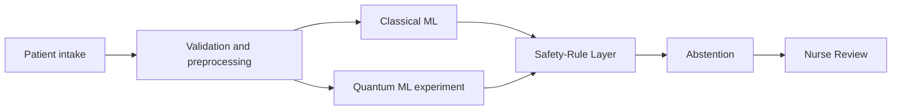

# OPD Sentinel

Decision support for nurse triage in an overloaded government hospital outpatient department. The tool suggests a triage level (1 is most urgent), a department, and any red-flag phrases it matched. A nurse confirms or overrides every case. It does not diagnose and it does not replace a doctor.

Classical ML is the live path. Quantum ML is an experiment on the PennyLane `default.qubit` simulator. No speedup and no quantum advantage are claimed. The Safety-Rule Layer can only keep or raise urgency. Reported numbers come from `reports/` after `make eval`. Until that file exists, the Evaluation page shows **Pending**.

## Architecture



A lower triage number is more urgent. Model output cannot lower a level the rules set.

## What is not in this repository

- The official intake file. `config/settings.yaml` maps logical fields to headers. Every official header is `null`, which means "the file already uses the logical name". **Do not guess headers.** When the organiser file arrives, put it at `data/raw/intake.csv` and set `column_map` to the real header row.
- The official `evaluate.py`. `make eval` writes a **local proxy** labelled `proxy, not official`. Under-triage of a true emergency costs 20 and over-triage costs 1, both set in `config/settings.yaml`. Replace that proxy when the official evaluator is provided. If a file appears at `evaluate.py` or `official/evaluate.py`, the eval command runs it with no arguments and still labels the tables in this repo as a proxy, because the official calling convention is not documented here.
- An official arrival log. `data/synthetic/arrivals_synthetic.csv` is a labelled stand-in for the wait-time simulation.

Clinical thresholds in `config/safety_rules.yaml` and `config/validation_ranges.yaml` are placeholders. Every rule has `clinically_reviewed: false`.

## Languages

Complaints can be typed in any script. The red-flag lexicon covers English, Hindi (roman and Devanagari), Telugu (roman and script), and a small Tamil set. Character n-grams cover other transliterations. The dashboard labels can be switched among English, Hindi, and Telugu. Those UI translations are drafts. The product names OPD Sentinel, Classical ML, Quantum ML, Safety-Rule Layer, and Nurse Review stay in English.

Synthetic complaints are generated in those languages and marked `record_source=synthetic`.

## Quick start

Requirements: Python 3.11+, Node.js 22+, GNU make.

```bash
make setup
make data
make train
make eval
make test
make demo
```

In two terminals:

```bash
make api
make web
```

Open http://127.0.0.1:5173 . Intake, Queue, Rules, Evaluation, and API status are in the header. Illustrative cases are labelled "Example, not a real clinical outcome".

`make data` prints split sizes and emergency prevalence. It does not print a model score. `make train` prints **validation** recall, missed emergencies, and asymmetric cost. It does not read the test split. `make eval` is the only command that scores the test split.

Docker:

```bash
docker compose up --build
```

The API seeds illustrative cases when `OPD_SEED_DEMO=1`. Mounted `backend/ml/artifacts` and `reports` are used when you have already trained and evaluated on the host.

## Layout

| Path | Role |
| --- | --- |
| `backend/app` | FastAPI, SQLite queue, append-only audit log |
| `backend/core` | Validation, Safety-Rule Layer, arbitration |
| `backend/ml` | Classical ML and experimental Quantum ML |
| `backend/eval` | Held-out proxy evaluation |
| `frontend` | Nurse dashboard |
| `config` | Column map, ranges, rules, red flags |
| `data/raw` | Official files, git-ignored |
| `data/synthetic` | Labelled synthetic stand-in |
| `reports` | Generated metrics only |

## Principles

- Safety rules win, and they never downgrade urgency.
- Reported numbers come from `reports/` after a real run. Otherwise the UI says Pending.
- Quantum ML is an experiment on PennyLane `default.qubit`. No speedup or advantage is claimed.
- Synthetic data and proxy scores are labelled as such.
- Hidden labels are never model inputs.
