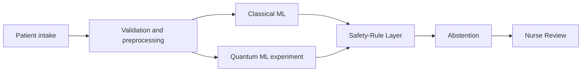

# OPD Sentinel

Decision support for nurse triage in an overloaded government hospital outpatient department. The tool suggests a triage level, a department, and any red-flag phrases it matched. A nurse confirms or overrides every case. It does not diagnose and it does not replace a doctor.

This repository is at **Phase 0** (scaffolding and a live health check). Classical ML, Quantum ML, the Safety-Rule Layer, and evaluation are not implemented. Anywhere a number would go, the status is **Pending**. No accuracy, recall, cost, or latency figure in this repo is a result.

## Architecture



The Safety-Rule Layer can only keep or raise urgency. A lower triage number is more urgent. Model output cannot lower a level the rules set. Quantum ML runs on a simulator and is not the live path.

## Assumptions for this build

- The workspace folder is the repository root. The product name is OPD Sentinel.
- The official intake file and the official `evaluate.py` are not in the repo. Column names in `config/settings.yaml` are logical fields with null file headers, not a guess at the official header row.
- When those files are still absent, later phases will use a clearly labelled synthetic dataset and a clearly labelled local cost proxy.
- Python 3.11 or newer. The API image uses Python 3.12.
- Clinical thresholds, once added, stay `clinically_reviewed: false` until a clinician reviews them.

## Quick start

Requirements: Python 3.11+, Node.js 22+, GNU make.

`make setup` installs the API, the test tools, and the Classical ML / PennyLane libraries. Installing PennyLane does not mean a quantum model has been trained.

```bash
make setup
make test
```

In two terminals:

```bash
make api
make web
```

Open http://127.0.0.1:5173 . The page calls `GET /health`.

`make data`, `make train`, `make eval`, and `make demo` exit with **Pending** until those phases exist. They do not print scores.

## Layout

| Path | Role |
| --- | --- |
| `backend/app` | FastAPI process. `GET /health` is live. |
| `backend/core` | Validation, Safety-Rule Layer, arbitration. Pending. |
| `backend/ml` | Classical ML and experimental Quantum ML. Pending. |
| `backend/eval` | Held-out evaluation. Pending. |
| `frontend` | Dashboard. The health page is live. |
| `config` | Column map and empty rule files. Thresholds are not clinical guidance. |
| `data/raw` | Official files, git-ignored. |
| `reports` | Generated metrics only. Empty. |

## What is still needed from outside this repo

- The official intake file and its real column headers, so `config/settings.yaml` can map them.
- The official `evaluate.py`, or a written definition of the asymmetric cost, so Phase 7 does not have to ship a labelled proxy.
- An arrival log if the wait-time comparison is in scope.

## Principles

- Safety rules win, and they never downgrade urgency.
- Reported numbers come from `reports/` after a real run. Otherwise the UI says Pending.
- Quantum ML is an experiment on PennyLane `default.qubit`. No speedup or advantage is claimed.
- Synthetic data and proxy scores are labelled as such.
- Hidden labels are never model inputs.
